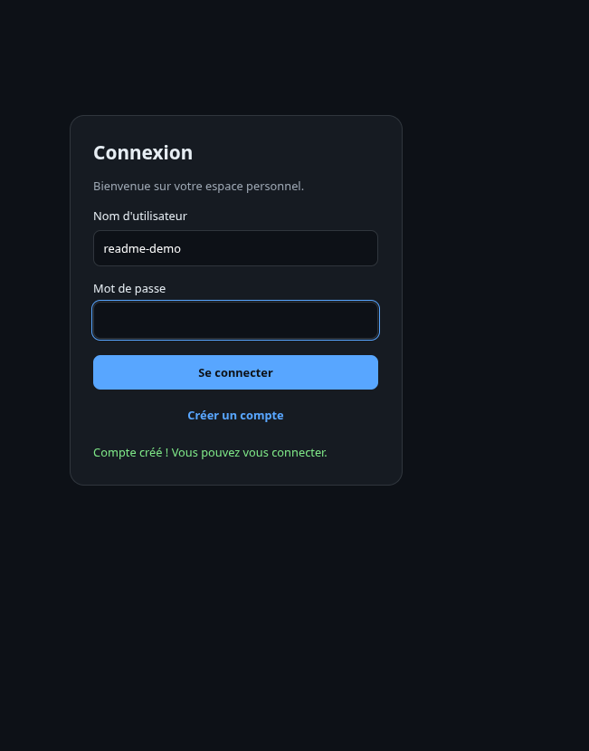
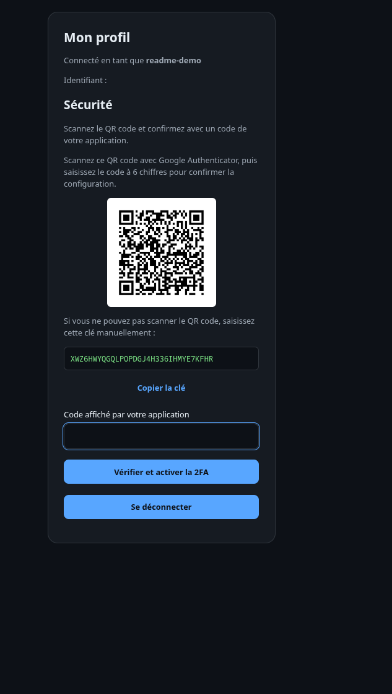

# FastAPI Auth - authentification à deux facteurs TOTP

> Application Web locale de démonstration : inscription, mot de passe haché, enrôlement avec QR code, codes TOTP et API protégée par JWT.

## Aperçu

L'interface HTML est servie par FastAPI à la racine (`/`). L'API et la page sont donc hébergées ensemble.





La seconde image montre un compte de démonstration créé uniquement pour la capture, puis supprimé de la base. Son QR code et sa clé ne sont plus valides.

## Fonctionnalités

- Inscription avec mot de passe haché par `scrypt` via Werkzeug.
- Connexion avec contrôle du mot de passe et limitation des tentatives.
- Première connexion : émission d'un JWT restreint à l'enrôlement, valable 10 minutes.
- Création d'un secret TOTP et d'un QR `otpauth://` après authentification du premier facteur.
- Activation de la 2FA seulement après vérification d'un premier code Google Authenticator.
- Connexions suivantes : mot de passe et code TOTP requis; un code déjà utilisé est refusé.
- Accès à `/auth/me` réservé aux JWT avec `scope=full` et `mfa=true`.
- Expiration de l'enrôlement et limitation des essais de confirmation à cinq échecs par fenêtre de cinq minutes.
- Stockage SQLite persistant avec Docker.

## Technologies

Python 3, FastAPI, SQLAlchemy, SQLite, PyOTP, qrcode, Werkzeug, PyJWT et HTML/CSS/JavaScript.

Le projet utilise FastAPI et des JWT Bearer, pas Flask/Jinja ni des cookies de session.

## Installation locale

Depuis la racine du projet, créez un environnement virtuel et installez les dépendances :

```bash
python3 -m venv .venv
source .venv/bin/activate
python -m pip install -r requirements.txt
```

Générez une clé de signature JWT pour votre environnement. Ne publiez pas cette clé et ne la remplacez pas par une valeur de production partagée :

```bash
export JWT_SECRET_KEY="$(python -c 'import secrets; print(secrets.token_hex(32))')"
```

Démarrez l'application :

```bash
uvicorn app.main:app --reload --host 127.0.0.1 --port 8000
```

Ouvrez [http://127.0.0.1:8000](http://127.0.0.1:8000). La documentation interactive de l'API est disponible sur [http://127.0.0.1:8000/docs](http://127.0.0.1:8000/docs).

Au premier démarrage, les tables SQLite sont créées automatiquement. Par défaut, la base est `auth.db` à la racine. Le chemin peut être remplacé avec `AUTH_DB_PATH`.

### Migration d'une ancienne base

Si vous avez déjà une base créée avant l'ajout de l'expiration des secrets en attente, effectuez la migration avant de lancer l'application. Le script crée une sauvegarde horodatée :

```bash
JWT_SECRET_KEY="$JWT_SECRET_KEY" python -m app.migrate_2fa
```

## Parcours utilisateur

1. **Inscription** : envoyer un nom d'utilisateur et un mot de passe (au moins 8 caractères). Le mot de passe en clair n'est pas enregistré.
2. **Connexion initiale** : saisir le nom et le mot de passe. Sans 2FA activée, l'API renvoie `2fa_enrollment_required: true` et un jeton `scope=enroll` de courte durée.
3. **Enrôlement** : l'interface envoie ce jeton à `/auth/2fa/setup`; l'utilisateur scanne le QR code avec Google Authenticator.
4. **Confirmation** : saisir le code à six chiffres dans `/auth/2fa/confirm`. Après vérification, le serveur active le secret et renvoie un jeton `scope=full`.
5. **Accès privé** : `/auth/me` accepte uniquement un jeton complet ayant validé le MFA.
6. **Connexions ultérieures** : saisir le code actuel de l'application avec le mot de passe. Le compteur TOTP empêche de réutiliser le même pas de temps.

Le secret en attente expire après 10 minutes. La page conserve le JWT uniquement en mémoire; son actualisation déconnecte l'utilisateur côté interface.

## Routes API principales

| Méthode | Route | Accès / rôle |
| --- | --- | --- |
| `GET` | `/` | Page HTML publique |
| `POST` | `/auth/register` | Création d'un compte |
| `POST` | `/auth/login` | Mot de passe; TOTP si déjà activé |
| `POST` | `/auth/2fa/setup` | JWT `enroll` ou `full`; renvoie le QR sans cache |
| `POST` | `/auth/2fa/confirm` | JWT `enroll` ou `full`; confirme le premier TOTP |
| `GET` | `/auth/me` | JWT `full` avec `mfa=true` obligatoire |

`/auth/register` et `/auth/2fa/confirm` reçoivent du JSON; `/auth/login` reçoit un formulaire URL-encoded. `/auth/2fa/setup` n'a pas de corps de requête. Voir `/docs` pour les détails de l'API.

## Exécuter les tests

Installez les dépendances de développement puis lancez pytest :

```bash
python -m pip install -r requirements-dev.txt
JWT_SECRET_KEY="$(python -c 'import secrets; print(secrets.token_hex(32))')" python -m pytest -q
```

Le test TestClient couvre l'inscription, le jeton restreint, le refus de `/auth/me` avant MFA, le QR, le blocage après cinq codes erronés, l'activation TOTP et le rejet d'un code rejoué.

## Lancer avec Docker

Le backend et le fichier HTML sont intégrés dans la même image. La base est conservée dans un volume Docker nommé.

Avec Docker Compose :

```bash
export JWT_SECRET_KEY="$(python3 -c 'import secrets; print(secrets.token_hex(32))')"
docker compose up --build -d
```

L'application est disponible sur [http://localhost:8000](http://localhost:8000). Pour arrêter le service sans supprimer les données :

```bash
docker compose down
```

Alternative sans Compose :

```bash
export JWT_SECRET_KEY="$(python3 -c 'import secrets; print(secrets.token_hex(32))')"
docker build -t fastapi-auth .
docker run -d --name fastapi-auth \
  -p 8000:8000 \
  -e JWT_SECRET_KEY="$JWT_SECRET_KEY" \
  -v fastapi_auth_data:/data \
  --restart unless-stopped \
  fastapi-auth
```

La clé doit rester secrète. Pour une exposition publique, placez l'application derrière un proxy HTTPS, protégez la clé et la base, et n'exposez pas le serveur de développement Uvicorn.

## Structure utile

```text
app/
  auth.py          routes, JWT, contrôle d'accès et logique MFA
  database.py      connexion et configuration SQLite
  main.py          création de l'application et route de la page HTML
  migrate_2fa.py   migration de l'ancienne base SQLite
  models.py        modèles User et LoginAttempt
  otp.py           secret TOTP, URI otpauth et génération du QR
  static/
    index.html     interface d'inscription, connexion et enrôlement
tests/
  test_auth_enrollment.py
Dockerfile
compose.yaml
requirements.txt
requirements-dev.txt
```